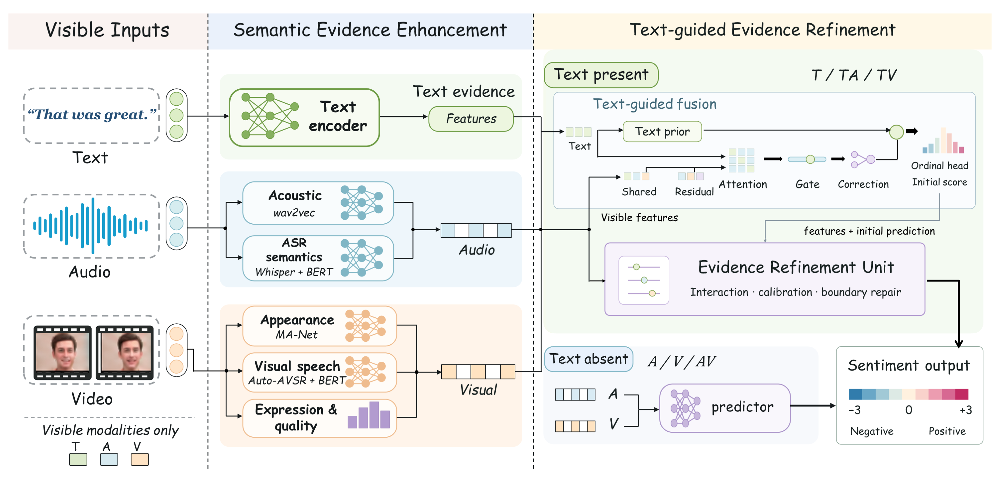
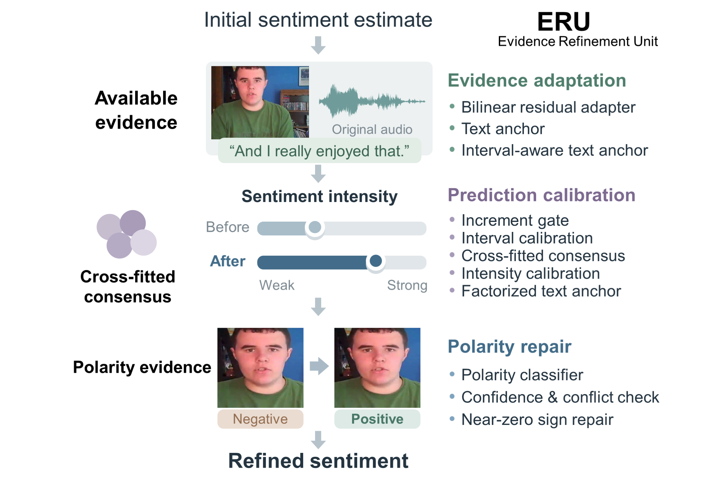

# EviSA

## Sentiment Analysis under Whole-Modality Missingness by Reading What Remains

**Read the evidence that remains. Use text as an anchor when it is available.**

EviSA studies multimodal sentiment analysis when an entire text, audio, or visual channel is unavailable. It enriches the visible audio and video with lexical and nonverbal evidence, selects a prediction path according to transcript availability, and produces one continuous sentiment score.

[Overview](#overview) · [Results](#results) · [Quick start](#quick-start) · [Data](docs/INPUTS.md) · [Reproduction](docs/REPRODUCE.md) · [Ablations](docs/FIXED_EXPERIMENT_CODE.md)

## Overview



[Motivation illustration](image/motivation.png)

### 1. Semantic evidence enhancement

Frozen feature extractors provide native acoustic and visual features, ASR-derived word semantics, visual speech representations and recognized words, facial expression cues, and visual quality descriptors. ASR words remain audio-derived evidence; lip-reading words remain video-derived evidence. Neither is the unavailable original transcript.

### 2. Modality-aware routing and text-guided evidence fusion

Inputs without the original transcript (**A, V, AV**) use the text-absent predictor. Inputs with the transcript (**T, TA, TV**) use the text-present path. TEF separates auxiliary evidence into text-explained and residual components, uses text-guided attention, and learns gated corrections to a text-based estimate.

### 3. Evidence refinement unit

ERU combines evidence adaptation, text anchors, cross-fitted consensus, intensity calibration, and confidence-conditioned near-zero polarity repair.

<details>
<summary>ERU components</summary>



The portraits, intensity bars, and polarity labels illustrate the mechanism, rather than measured before/after predictions for that example.
</details>

## Evaluation settings

The letters below indicate **available** original modalities. T = text, A = audio, V = video.

| Setting | Available | Missing |
|---|---|---|
| A | Audio | Text, video |
| V | Video | Text, audio |
| AV | Audio, video | Text |
| T | Text | Audio, video |
| TA | Text, audio | Video |
| TV | Text, video | Audio |

The repository focuses on these six whole-modality settings. Frozen extractors are shared, while the prediction paths depend on the available channels. See [Architecture](docs/ARCHITECTURE.md) for the implementation mapping.

## Results

The following are the frozen EviSA results used in the current manuscript, not measurements from a new run of this repository update.

| Dataset | Available modalities | Acc-2 ↑ | F1 ↑ | MAE ↓ | Corr ↑ |
|---|---|---:|---:|---:|---:|
| MOSEI | A | 81.92 | 81.78 | 0.5993 | 0.6897 |
| MOSEI | V | 78.10 | 77.59 | 0.6473 | 0.6188 |
| MOSEI | AV | 82.28 | 82.16 | 0.5782 | 0.7035 |
| MOSEI | T | 86.65 | 86.62 | 0.5133 | 0.7841 |
| MOSEI | TA | 86.96 | 86.90 | 0.5039 | 0.7918 |
| MOSEI | TV | 87.04 | 86.99 | 0.4913 | 0.8014 |
| MOSI | A | 78.66 | 78.69 | 0.9588 | 0.6425 |
| MOSI | V | 67.99 | 68.17 | 1.1259 | 0.5078 |
| MOSI | AV | 78.05 | 78.17 | 0.9545 | 0.6598 |
| MOSI | T | 85.21 | 85.20 | 0.7149 | 0.8122 |
| MOSI | TA | 86.13 | 86.08 | 0.7055 | 0.8154 |
| MOSI | TV | 86.43 | 86.37 | 0.7015 | 0.8181 |

Acc-2 and support-weighted F1 are percentages computed on non-zero ground-truth labels. MAE and Pearson correlation use all test samples. Each row uses the same continuous prediction for classification and regression. No average across missing-modality settings is reported.

- [Full comparison with baselines](results/paper/main_results.csv)
- [Frozen ablation results](results/paper/ablation_results.csv)
- [Paired component gains](results/paper/module_gains.csv)
- [Result provenance and interpretation](results/README.md)

## Repository structure

```text
EviSA/
├── image/                   # Framework and component illustrations
├── src/evidence_msa/
│   ├── features/            # Alignment and packing of extracted features
│   ├── text_absent/         # A / V / AV prediction
│   ├── text_present/        # TEF, ERU, training, and calibration
│   ├── common/              # Metrics and checkpoint utilities
│   └── inference.py         # Label-free prediction and modality routing
├── configs/                 # Frozen protocol and feature provenance
├── experiments/             # Fixed ablations and EMT/MISA repair adapters
├── docs/                    # Inputs, architecture, and reproduction details
├── results/                 # Aggregate paper tables and earlier references
├── tests/                   # Metric, isolation, and source-equivalence checks
├── archive/                 # Extraction sources and frozen implementation snapshots
├── release/                 # Runtime hashes and earlier verification records
├── run.py                   # Command-line entry point
└── requirements.txt
```

The `src/evidence_msa` package layout is retained to preserve imports, checkpoint compatibility, and runtime hashes. Historical full-modality TAV queues are available in Git history at commit `9ddcb6d`; they are not part of this paper-focused tree.

## Quick start

### Environment

The previously checked environment uses Python 3.10, PyTorch 2.3.1 with CUDA 11.8, NumPy 1.24.4, and scikit-learn 1.3.2. Install a PyTorch build compatible with your NVIDIA driver, then install the task-head dependencies:

```bash
git clone https://github.com/YNWAcop/EviSA.git
cd EviSA
conda create -n evisa python=3.10
conda activate evisa
pip install -r requirements.txt
python run.py --help
python -m unittest discover -s tests -v
```

Raw-media extraction has additional model and software dependencies listed in [Third-party resources](THIRD_PARTY.md). Text-path training and complete text-path inference require CUDA.

### Data preparation

Obtain the datasets and external model assets under their respective terms. Prepare the frozen feature caches described in [Inputs](docs/INPUTS.md):

```text
data/
└── ready/
    ├── mosi/{train,valid,test}.npz
    └── mosei/{train,valid,test}.npz
```

```bash
python run.py --data-root ./data check
```

The check verifies runtime hashes and feature-file headers; it does not train or calculate test metrics. `prepare-inputs` packs existing caches; it does not download models or extract raw media automatically. Dataset files, pretrained weights, and trained checkpoints are not bundled.

### Training and evaluation

Train the fixed text-present path for both datasets in a new output directory:

```bash
python run.py --data-root ./data --run-root ./runs/text_present train-text
python run.py --run-root ./runs/text_present status
```

After both datasets have locked checkpoints, evaluate explicitly:

```bash
python run.py --data-root ./data --run-root ./runs/text_present evaluate-text
```

For a fresh text-absent run:

```bash
python run.py --data-root ./data train-v1 --dataset mosi --condition AV --out ./runs/mosi_AV
```

This trains a new task head. The portable V1 entry point does not guarantee exact reproduction of historical A/V/AV ensemble outputs. See [Reproduction](docs/REPRODUCE.md) for checkpoint requirements and the distinction between fresh training and replay.

No seed sweep or multi-seed training is scheduled. Each experimental configuration is a single run selected using validation data. ERU's four grouped cross-fitted submodels are internal components, not repeated random-seed trials. Resuming may restore RNG state.

### Prediction

```bash
python run.py predict --condition TA --input ./data/ready/mosi/test.npz --model-dir ./runs/text_present/runs/mosi/fold_0 --output ./runs/pred_mosi_TA.npz
python run.py score --predictions ./runs/pred_mosi_TA.npz --labels ./data/ready/mosi/test.npz --output ./runs/metrics_mosi_TA.json
```

Prediction does not read labels. Scoring aligns predictions and labels by unique sample IDs. Existing prediction and score files are protected against overwrite.

## Fixed ablations

The retained experiments cover the paper's component ablations and Native/Enhanced input comparisons. Their original source versions are preserved; external data manifests and assets must be restored before running them. See [Fixed experiments](docs/FIXED_EXPERIMENT_CODE.md) for dependencies and the comparison matrix.

## Paper and citation

Manuscript: **Sentiment Analysis under Whole-Modality Missingness by Reading What Remains**. A public paper link and formal BibTeX entry will be added when available.

## Acknowledgments

EviSA uses CMU-MOSI/CMU-MOSEI and frozen representations or models including wav2vec 2.0, Whisper, BERT, MA-Net, Auto-AVSR, and EmotiEffLib. See [Third-party resources](THIRD_PARTY.md) and `configs/input_provenance/` for asset provenance. The qualitative modality-imbalance sketch in the motivation illustration follows the EBMC reference acknowledged in the manuscript.

For implementation questions, please open a [GitHub issue](https://github.com/YNWAcop/EviSA/issues).
